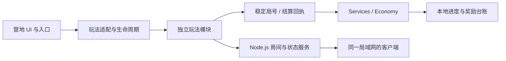

# 多玩法二维游戏与交互系统

使用 **JavaScript / Canvas 2D / Node.js** 构建的多玩法游戏系统，来自“再来亿把”项目。以营地大厅为统一宿主，连接合作闯关、弹珠战斗、经营、塔防、挖矿、牌局等玩法，覆盖游戏生命周期、局域网交互、进度迁移和奖励结算。

当前主工作目录的版本标记为 **1.27.0**；源码包含后续面包工坊主动经营扩展，不能把已有同版本安装包直接视为该源码的完整构建产物。此仓库提供源码审阅与逻辑验证范围，部分运行素材未分发。

## 系统能力与业务问题

| 能力 | 技术实现 | 解决的问题 |
|---|---|---|
| 多玩法宿主 | 统一入口、加载、暂停、退出、销毁与返回营地 | 各玩法生命周期不一致、离场资源残留 |
| 独立玩法模块 | Canvas 2D 渲染、碰撞、强化、关卡及经营状态 | 玩法扩展与大厅逻辑相互耦合 |
| 统一经济层 | 稳定回执 ID、奖励台账、保存后提交与防重结算 | 重复领取、异常重试和存档写入失败 |
| 局域网交互 | HTTP / WebSocket 房间、准备与开始、状态同步、离房和重连规则 | 多客户端状态分歧与房间边界错误 |
| 进度与迁移 | 版本化钱包、玩法独立进度、旧记录保留与迁移校验 | 升级后存档不兼容或重复补偿 |
| Android 宿主 | 原生容器与局域网相关源码，复用 Web 玩法 | 多入口整合与移动端承载 |

## 架构与模块职责



| 代码入口 | 职责 |
|---|---|
| [`app.js`](app.js)、[`adapters.js`](adapters.js)、[`platform.js`](platform.js) | 大厅协调、玩法加载与宿主能力 |
| [`services.js`](services.js)、[`economy.js`](economy.js) | 钱包迁移、任务、奖励、回执去重和持久化提交 |
| [`server.mjs`](server.mjs) | HTTP 服务与合作 / 牌局的联机入口 |
| [`games/coop`](games/coop) | 合作关卡、输入与状态同步、服务端规则 |
| [`games/marble`](games/marble)、[`games/rush`](games/rush) | 弹珠与动作战斗、强化选择、碰撞及恢复 |
| [`games/workshop`](games/workshop)、[`games/nightwatch`](games/nightwatch) | 经营生产与守城成长循环 |
| [`games/liars`](games/liars)、[`games/chess`](games/chess) | 牌局规则、房间流程与回合反馈 |
| [`tests`](tests)、[`tools`](tools)、[`android`](android) | 规则回归、模拟诊断与 Android 宿主工程 |

## 关键技术设计

### 生命周期与状态管理

大厅通过适配层协调不同玩法的进入、恢复、退出和结算。加载中的退出使用失效状态阻止旧入口重新生效，销毁绘制、音频和网络连接；单人暂停与联机持续运行分别处理。

游戏进度与营地钱包分开管理，避免把某个玩法内部货币直接当统一钱包。流程采用状态与事件驱动组织，界面提示依据实际加载、房间及结算状态更新。

### 幂等结算与持久化提交

奖励采用 **Idempotency（幂等）** 与 **Receipt / Ledger（回执与台账）**：稳定局号、任务 ID 和首通回执限定到账次数。`createServices` 在状态副本上执行命令，存储成功后才替换当前内存状态；写入失败不提前显示永久入账。

`economy.js` 保留版本迁移和历史回执语义。旧首通记录用于确认已获得的权益，不借升级重新发放奖励；重复领取、失败保存与续关差额均有对应回归。

### 房间协议与跨客户端交互

Node.js 服务组织合作与牌局的房间、准备、回合和同步状态。真实联机要求客户端访问同一个可互通的服务；离线机器人、局域网真人与本地钱包分别标明边界，不将本地结算宣称为可信跨设备经济系统。

## 逻辑验证与运行条件

建议 Node.js 22+。以下命令可在 **Windows PowerShell 或 Bash** 的项目根目录执行，不依赖完整画面素材：

```sh
node --test tests/services.test.mjs tests/adventure.test.mjs tests/economy.test.mjs
```

本次复验结果与范围见 [`VALIDATION.md`](VALIDATION.md)。`package.json` 还保留各玩法及浏览器检查入口，其中部分检查依赖完整资源或浏览器环境，不应据此宣称公开副本全套均可运行。

完整资源环境下使用 `node server.mjs` 启动宿主，默认访问 `http://127.0.0.1:4173`。当前 GitHub 副本未收录授权尚未核实的美术、音频和魔塔地图，直接启动可能出现资源缺失；不作为完整游戏发行包。

## 同步范围、许可与后续工作

2026-10-15 已核对发布范围内的代码与当前主工作目录一致，保留原始规格、测试、依赖配置和工程资料。源码清单见 [`SOURCE_INVENTORY.json`](SOURCE_INVENTORY.json)。

合作地图改编来源 Super Lemonade Factory OUYA，保留可编辑地图、转换工具及 GPL-3.0 声明；CardRoomPro、字体等按各自许可保留。详见 [`THIRD-PARTY-NOTICES.txt`](THIRD-PARTY-NOTICES.txt) 与 [`licenses`](licenses)，不统一改成 MIT。

商业素材授权、真实广告 / 支付接入、可信跨设备钱包、弱网长时运行及平台发行属于后续范围。广告接口当前保留开发模拟语义，不以逻辑回归替代实体手机、画面还原或商业发行验收。
